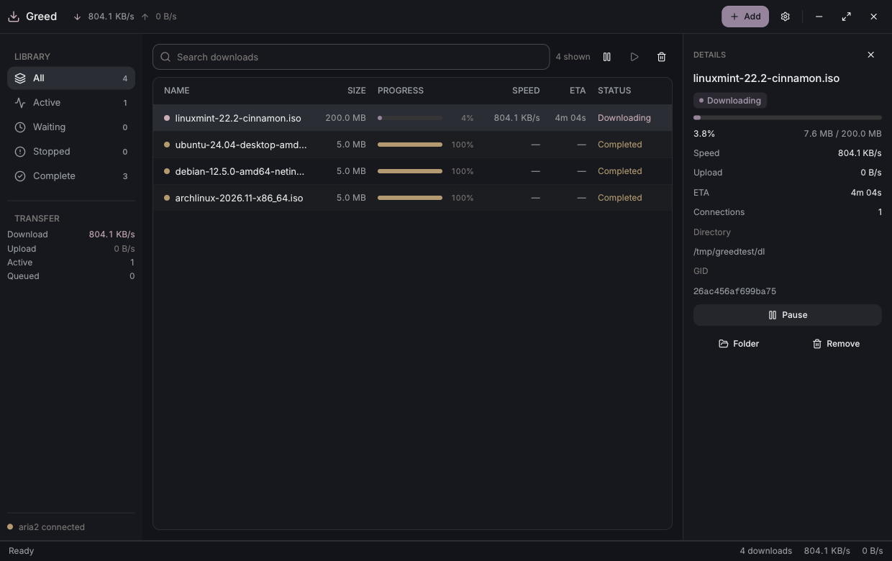

# Greed

A dark download manager for Linux. GUI and CLI in one C binary, powered by
[aria2](https://aria2.github.io/) and drawn with [CUI](https://github.com/yappologistic/CUI).




## Features

- **aria2 core**: HTTP/HTTPS/FTP, BitTorrent, Metalink; resume, multi-connection, checksums
- **Bundled aria2**: `vendor/aria2/` ships with the repo; falls back to a system `aria2c`
- **Frameless window**: the title bar is drawn inside the app, with drag, minimize, maximize and edge resize
- **GUI**: 76 themes (default Dark Mono), sidebar tabs (All/Active/Waiting/Stopped/Complete), a
  searchable download table with progress, speed, ETA and status, a per-download details pane and
  a live transfer sparkline in the sidebar
- **Keyboard first**: a command palette, full list navigation and an optional Vim mode; every
  destructive action asks first
- **Bulk actions**: drag a selection band or check several downloads, then pause, resume or
  remove them in one go
- **CLI**: `greed add/list/status/pause/resume/remove/stats/shutdown`, with `--json` for
  `list` and `status`
- **Torrents**: magnet links and `.torrent` files (file contents are base64-encoded for aria2)
- **Bandwidth control**: global download/upload caps in KB/s, applied to the running engine,
  with a live throughput chart that draws the cap on the line
- **Seeding**: keep sharing completed torrents up to a chosen ratio
- **Statistics**: 60-second throughput chart with peak marker, live download/upload speeds and a
  download-folder card with free space and an Open folder button
- **Scheduled downloads**: presets or an exact date and time; Greed hands the link to aria2 when it is due
- **Settings**: General, Bandwidth, Torrents, Appearance and Keys tabs; theme, font family,
  text size, spacing, motion, engine limits and a keymap diagram
- **Clipboard monitoring**: offers a toast when a link is copied (toggleable)
- **Notifications**: desktop notification when a download completes (toggleable)
- **Session persistence**: the queue survives restarts through aria2's session file
- **Live stats**: global and per-download speed, size, ETA, connections, seeders

## Requirements

- Linux (X11; on Wayland it runs through XWayland)
- OpenGL (falls back to software rendering)
- C compiler, CMake, libcurl, json-c, X11 headers

Arch:

```sh
sudo pacman -S base-devel cmake curl json-c libx11
```

Debian/Ubuntu:

```sh
sudo apt install build-essential cmake libcurl4-openssl-dev libjson-c-dev libx11-dev
```

aria2 is bundled, so nothing else is needed. A system `aria2c` is only used when the
bundled one is missing.

## Build

```sh
git clone https://github.com/domesticsilk/greed.git
cd greed
cmake -S . -B build -DCMAKE_BUILD_TYPE=Release
cmake --build build -j
./build/greed
```

`cui.c` is the large translation unit (~30 s on a slow machine); CMake builds it once as a
static library, so later rebuilds only touch the app sources.

## Usage

```sh
greed                              # open the GUI
greed add https://example.com/file.zip
greed add magnet:?xt=urn:btih:...  # magnet
greed add ./debian.torrent         # torrent file
greed add URL -d ~/Downloads -o name.iso -x 8
greed list [--json]
greed status <gid> [--json]
greed pause <gid>...
greed resume <gid>...
greed remove <gid>... [--delete]   # --delete also drops the stopped result
greed stats
greed shutdown                     # stop the aria2 engine
```

`greed` with no arguments opens the GUI when `DISPLAY` or `WAYLAND_DISPLAY` is set, and
prints help otherwise.

Keyboard shortcuts:

| Where | Keys | Action |
| --- | --- | --- |
| Anywhere | `Ctrl+K` | Command palette |
| Anywhere | `Ctrl+N` / `Ctrl+,` | Add download / Settings |
| Anywhere | `Ctrl+B` | Toggle sidebar |
| Anywhere | `Ctrl+1` `Ctrl+2` `Ctrl+3` | Downloads / Statistics / Scheduled |
| Anywhere | `?` / `Ctrl+Q` | Shortcuts / quit |
| List | `Up` `Down` `Home` `End` `PgUp` `PgDn` | Move the cursor |
| List | `Enter` / `Space` / `Delete` | Details / pause or resume / remove |
| List | `Ctrl+A` | Select all |
| Vim mode | `j` `k` `gg` `G` | Move the cursor |
| Vim mode | `Ctrl+D` `Ctrl+U` | Page down / up |
| Vim mode | `h` `l` | Previous / next tab |
| Vim mode | `x` / `dd` / `o` / `/` | Toggle / remove / add / search |
| Vim mode | `:` | Command palette |
| No Vim | `Ctrl+F` | Search |

`Esc` clears the selection or closes the open dialog. Settings scrolls with `PgUp`/`PgDn`.

## Configuration

`~/.config/greed/config.json` (or `$XDG_CONFIG_HOME/greed/config.json`):

```json
{
  "download_dir": "~/Downloads",
  "max_concurrent": 5,
  "rpc_port": 6800,
  "max_download_limit": 0,
  "max_upload_limit": 0,
  "seed_after_complete": true,
  "seed_ratio": 1.0,
  "auto_start_aria2": true,
  "clipboard_monitor": true,
  "notify_on_complete": true,
  "verify_after_complete": true,
  "theme": "Dark Mono",
  "font": "default",
  "text_scale": 1.0,
  "spacing": 1.0,
  "motion_speed": 1.0,
  "vim_mode": false
}
```

`font` is one of `default`, `sans`, `serif` or `mono`; `text_scale` ranges from 0.85 to 1.3 and
`spacing` from 0.9 to 1.12. The same values can be changed in Settings > Appearance.

The limits are in KB/s; 0 means unlimited. The aria2 session is saved next to it as
`aria2.session`. The same directory and format are used by the earlier Rust version.

## Layout

```
src/main.c     CLI/GUI dispatch
src/ui.c       CUI interface: title bar, sidebar, table, details, dialogs, toasts
src/logo.h     titlebar wordmark alpha mask (generated asset)
src/model.c    aria2 JSON parsing and formatters
src/rpc.c      JSON-RPC over libcurl, aria2 discovery/spawn, base64
src/config.c   config file
src/cli.c      subcommands
src/x11.c      frameless window, drag/resize, maximize, minimize
vendor/cui/    CUI 1.4.0 amalgamation (MIT)
vendor/aria2/  aria2c + libaria2 (GPL-2.0)
```

## License

GPL-2.0. CUI is MIT-licensed and vendored under `vendor/cui/LICENSE`; aria2 is GPL-2.0 and
vendored under `vendor/aria2/`.

The titlebar wordmark (`src/logo.h`) is a rendered image of the Stitch Warrior demo font,
which is free for personal use only. The font file itself is not included, and the wordmark
is not covered by the GPL; replace it if you need a different license.
