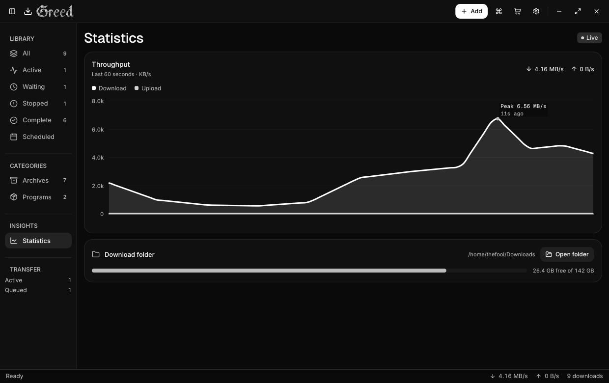
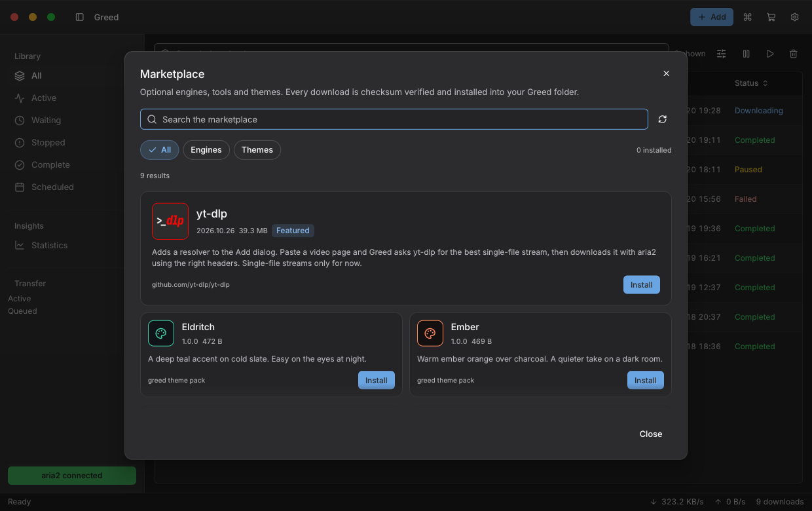

<p align="center">
  
</p>

<h1 align="center">Greed</h1>

<p align="center"><strong>A dark, keyboard-first download manager for Linux.</strong></p>

Greed pairs a native desktop window with a complete command-line interface in one C binary.
Both drive the same aria2 session: a download started in the window appears in the terminal,
links handed over by the browser land in the same list, and the core workflow works from the
keyboard alone. aria2 handles the transfers, CUI draws the interface, and there is no web
runtime in between.

[](LICENSE)


<p align="center">
  
  
</p>

*The Statistics view tracks throughput, transfer limits and free space. The Marketplace screenshot uses the optional Liquid Glass theme.*

## Contents

- [Features](#features)
- [Requirements](#requirements)
- [Build](#build)
- [AppImage](#appimage)
- [Browser extension](#browser-extension)
- [Usage](#usage)
- [Keyboard shortcuts](#keyboard-shortcuts)
- [Marketplace](#marketplace)
- [Configuration](#configuration)
- [Project layout](#project-layout)
- [License](#license)

## Features

**Download engine**

- HTTP, HTTPS, FTP, BitTorrent and Metalink downloads through aria2
- Video pages through yt-dlp, with Best, 1080p, 720p, 480p and 360p quality choices; separate
  video and audio streams merge into one MP4 or MKV with ffmpeg
- Resume, multiple connections per download and checksum verification
- Bundled aria2 runtime, with a fallback to the system `aria2c`
- Global download and upload limits in KB/s, applied live, with a throughput chart that draws
  the cap
- HTTP proxy support with optional credentials and a bypass list, applied to the running engine
  when settings are saved
- Per-download request headers: Referer, User-Agent, cookies and any extra `Name: value` line,
  set in the Add dialog or with `greed add`; values stay in memory and are never saved
- Seeding control: keep sharing completed torrents up to a chosen ratio
- Scheduled downloads by preset or exact date and time
- Torrent inspector with per-file progress, skipped files, peer state and live peer speeds
- Session persistence through aria2's session file

**Interface**

- Frameless window with an internal title bar for dragging, minimizing, maximizing and resizing;
  the minimum window size is 640x420
- 76 built-in themes, with Dark Mono as the default, plus marketplace theme packs
- Optional Liquid Glass theme with light and dark variants, a unified toolbar, traffic lights and
  optical glass on the toolbar, sidebar and dialogs
- Sidebar tabs for All, Active, Waiting, Stopped and Complete
- Automatic file-type categories (Video, Audio, Images, Documents, Archives, Programs, Other)
  that appear once they have downloads and filter the list when clicked
- Resizable sidebar from 140 to 420 px, with live transfer speeds in the status bar
- Searchable download table with Name, Size, Progress, Speed, ETA, Added, Location, Connections
  and Status; every column except Name can be hidden
- YouTube rows show a three-dot orbit spinner while they download or merge; other rows use the
  status dot
- Click a header to sort, drag a divider to resize the column on its right, and use the Columns
  menu to show, hide or reset columns; sort order and widths persist across restarts
- Details pane on the right for the selected download, with progress, size, speed, ETA, Added
  time, save location, connections, seeders and files
- Statistics view with a 60-second chart, peak marker, live speeds and a download-folder card
  with free space and an Open folder button
- Clipboard monitoring and desktop notifications on completion
- Settings for General, Network, Torrents, Appearance, Keys and Updates, including theme, any
  installed font, logo style, text size, sidebar width, spacing, motion, an animations switch,
  engine limits and a keymap diagram

**Workflow**

- Row actions: open a finished file, open its folder, copy the source link or retry a failed
  download
- Bulk selection by drag band, `Ctrl+click` or `Shift+Up/Down`: two or more downloads open a
  bottom panel of side-by-side cards, then pause, resume, remove or deselect them one by one; a
  single selection keeps the details pane on the right
- Add dialog with a per-download directory, file name and connection count, plus a quality picker
  for video pages

**Keyboard and accessibility**

- Command palette, full list navigation and an optional Vim mode
- Confirmation before destructive actions
- WCAG AA text contrast on every theme surface, focus rings with 3:1 non-text contrast and
  visible keyboard focus
- The complete workflow is available without a mouse

**System integration**

- Single-instance window: later launches hand their links to the running instance and raise it
- Background tray icon while downloads continue after the window closes, on X11 desktops with an
  XEmbed system tray; click it to reopen Greed
- `.torrent`, `.metalink` and `magnet:` handlers, plus drag and drop for torrent and metalink files
- CLI commands for scripting and headless use
- In-app updates from Settings > Updates, with AppImage replacement or installation to
  `~/.local/bin/greed`, after checking the release SHA-256
- Chromium extension for right-click downloads, through a small native messaging helper in C
- Marketplace for optional engines, tools and themes, with SHA-256 verification

## Requirements

- Linux with X11; on Wayland, Greed runs through XWayland
- OpenGL, with a software-rendering fallback
- A C compiler, CMake, libcurl, json-c and X11 development headers

Arch:

```sh
sudo pacman -S base-devel cmake curl json-c libx11 libxext
```

Debian/Ubuntu:

```sh
sudo apt install build-essential cmake pkg-config libcurl4-openssl-dev libjson-c-dev libx11-dev libxext-dev
```

aria2 is bundled, so no separate installation is required. A system `aria2c` is used only when
the bundled binary is missing.

## Build

```sh
git clone https://github.com/domesticsilk/greed.git
cd greed
cmake -S . -B build -DCMAKE_BUILD_TYPE=Release
cmake --build build -j
./build/greed
```

`vendor/cui/cui.c` is the large translation unit, taking about 30 seconds on a slow machine.
CMake builds it once as a static library, so later rebuilds only compile the application sources.

Run the test suite from the build directory:

```sh
cd build
ctest --output-on-failure
```

## AppImage

Download `Greed-x86_64.AppImage` from the
[latest release](https://github.com/domesticsilk/greed/releases/latest), then:

```sh
chmod +x Greed-x86_64.AppImage
./Greed-x86_64.AppImage
```

For a release, build inside an Ubuntu 22.04 rootfs so the binary needs no newer than glibc 2.35:

```sh
./packaging/build-portable.sh
```

The script downloads the Ubuntu base rootfs once, installs the build dependencies inside it,
runs the tests, and writes `build/Greed-x86_64.AppImage` with aria2 and its private libraries
bundled. It needs user namespaces (`unshare -r`), not Docker. Greed itself uses the system
libcurl, json-c and X11 libraries.

For a quick local build against the bundled Arch binaries, use
`./packaging/build-appimage.sh` instead. Both scripts download `appimagetool` on first use and
fall back to extracting it when FUSE is unavailable.

Pushing a `v*` tag runs `.github/workflows/release.yml`, which checks that the tag matches
`GREED_VERSION`, builds the AppImage, writes `Greed-x86_64.AppImage.sha256`, packages the browser
extension and publishes the three assets with the release notes from `CHANGELOG.md`. Settings >
Updates looks for that exact
name and compares the release tag with `GREED_VERSION` in `src/version.h`; it checks the
`.sha256` asset before replacing the running file. On distributions without libfuse2, install it
or start the file with `--appimage-extract-and-run`.

## Browser extension

`extension/` is a Chromium extension for Chrome, Chromium, Helium, Brave, Edge, Vivaldi and
Opera. It sends the link under the cursor to Greed through a native messaging helper written in C.

```sh
greed browser install
```

That registers the helper for every browser profile it finds. Then open `chrome://extensions`,
enable Developer mode, choose Load unpacked and select the `extension/` folder. With the release
archive, unzip `Greed-extension.zip` and select that folder; packages install the same files under
`/usr/share/greed/extension`. Right-click a link, image, video or audio and choose Download with
Greed. The helper starts Greed when it is not already running. See
[extension/README.md](extension/README.md) for limits and removal.

## Usage

### GUI

```sh
greed                              # open the GUI
greed https://example.com/file.zip # open the Add dialog with the link
greed https://youtu.be/...         # video page in the Add dialog
greed magnet:?xt=urn:btih:...      # magnet in the Add dialog
greed ./debian.torrent             # torrent or metalink file in the Add dialog
```

With no arguments, `greed` opens the GUI when `DISPLAY` or `WAYLAND_DISPLAY` is set and prints
help otherwise. A bare link or torrent/metalink path opens the GUI with the Add dialog filled; on
a machine without a display, it falls back to `greed add`.

### CLI

```sh
greed add https://example.com/file.zip
greed add magnet:?xt=urn:btih:...
greed add ./debian.torrent
greed add URL -d ~/Downloads -o name.iso -x 8
greed add URL --referer https://example.com/watch --cookie "session=abc" \
  -H "Accept-Language: en" -H "X-Requested-With: Greed"
greed list [--json]
greed status <gid> [--json]
greed pause <gid>...
greed resume <gid>...
greed remove <gid>... [--delete]   # --delete also drops the stopped result
greed stats
greed shutdown                     # stop the aria2 engine
```

### Request headers

Some servers need a Referer, a browser User-Agent or a session cookie. Set them in the Add
dialog under Request headers, or pass them to `greed add`:

```sh
greed add URL --referer https://example.com/ --user-agent "Mozilla/5.0 ..." \
  --cookie "name=value; name2=value2" -H "Accept-Language: en"
```

`-H` takes one `Name: value` per flag and can be repeated. A field wins over an extra line with
the same name, so there are no duplicate headers. For video pages, yt-dlp receives the same
headers and aria2 gets them for the direct link; yt-dlp reads them from an unlinked mode-0600
file, so cookies do not appear in the process list. Values are held in memory only: they are
never written to the config, the aria2 session or the history. aria2 sends them on every request
for that download, including redirects to another host.

### Single instance

Only one GUI runs per user. A second `greed` or `greed <link>` writes the links to the running
instance, raises its window and exits. The running window opens the Add dialog, or appends to the
open one. The lock and handoff files live in `$XDG_RUNTIME_DIR`, or `/tmp` when it is unset.

### Background engine

aria2 runs as a daemon. Closing the Greed window leaves active and waiting downloads running;
start Greed again to reconnect. `greed shutdown` stops the engine and any running downloads.
On X11 desktops with an XEmbed system tray, closing the window while downloads are active leaves
an icon in the tray with the active count in its tooltip. Click it to reopen Greed. The icon goes
away when the queue finishes, the engine stops, or Greed starts again. Desktops without XEmbed
support (for example stock GNOME) show no icon; downloads still continue. `greed tray` runs the
indicator in the foreground.

### Desktop integration

`packaging/greed.desktop` registers `application/x-bittorrent`, `application/metalink4+xml`,
`application/metalink+xml` and `x-scheme-handler/magnet`, and uses `Exec=greed %U`. Install it
under `~/.local/share/applications/` and run:

```sh
xdg-mime default greed.desktop application/x-bittorrent
xdg-mime default greed.desktop application/metalink4+xml
xdg-mime default greed.desktop application/metalink+xml
xdg-mime default greed.desktop x-scheme-handler/magnet
```

Drag and drop accepts `.torrent` and `.metalink` files. X11 forwards file URIs only, so a link
dragged from a browser is not delivered; copying it works through clipboard monitoring.

### Table controls

- Click a column header to sort by that column. Click the same header again to reverse the order.
- Use the Columns button in the toolbar to show or hide columns. Name is always visible.
- Drag the divider at a column's left edge to resize it. The column to the right of the divider
  changes width; Name absorbs the difference.
- Choose Reset columns to restore the default columns and widths.

## Keyboard shortcuts

| Where | Keys | Action |
| --- | --- | --- |
| Anywhere | `Ctrl+K` | Command palette |
| Anywhere | `Ctrl+N` / `Ctrl+,` | Add download / Settings |
| Anywhere | `Ctrl+B` | Toggle sidebar |
| Anywhere | `Ctrl+1` `Ctrl+2` `Ctrl+3` | Downloads / Statistics / Scheduled |
| Anywhere | `?` / `Ctrl+Q` | Shortcuts / quit |
| List | `Up` `Down` `Home` `End` `PgUp` `PgDn` | Move the cursor |
| List | `Enter` / `Space` / `Delete` | Details / pause or resume / remove |
| List | `Ctrl+A` | Select all |
| List | `Ctrl+I` | Download info (Overview, Files, Peers) |
| Vim mode | `j` `k` `gg` `G` | Move the cursor |
| Vim mode | `Ctrl+D` `Ctrl+U` | Page down / up |
| Vim mode | `h` `l` | Previous / next tab |
| Vim mode | `x` / `dd` / `o` / `/` / `i` | Toggle / remove / add / search / info |
| Vim mode | `:` | Command palette |
| No Vim | `Ctrl+F` | Search |

`Esc` clears the selection or closes the open dialog. Settings and the Add dialog scroll with
`PgUp`/`PgDn`.

## Marketplace

The cart button in the title bar, or the command palette, opens the Marketplace. It lists
optional engines, tools and theme packs from
`https://raw.githubusercontent.com/domesticsilk/greed/main/marketplace/catalog.json`, with a
built-in copy when the network or the catalog is unavailable.

- Every asset is downloaded to a temporary file, checked against the `sha256` in the catalog,
  and only then moved into place.
- Installs go to `~/.local/share/greed/` (or `$XDG_DATA_HOME/greed/`): themes under `themes/`,
  tools under `tools/<id>/`. Nothing outside that folder is written.
- The catalog is cached as `~/.local/share/greed/marketplace/catalog.json`, and installed items
  are tracked in `installed.json` next to it. Remove deletes the installed file.
- yt-dlp resolves video pages. Install it, enable "Resolve video pages with yt-dlp" in the Add
  dialog, and pick Best, 1080p, 720p, 480p or 360p. Greed prefers a single progressive stream at
  the requested height. When the site only offers separate streams, it downloads the video and
  audio halves with aria2 and merges them with ffmpeg.
- ffmpeg merges those halves. It is a static 6.0 build from the catalog and installs next to
  yt-dlp. Without it, qualities above 360p fall back to the best combined stream and the dialog
  says that ffmpeg is needed.
- The merged container is MP4 when the video is MP4 and the audio is M4A or MP4; otherwise it is
  MKV. The final file takes the video's name, and the audio half is deleted after a successful
  merge. If that name already exists, aria2 saves the new video half as `name.1.ext` and the
  merge follows that name, so the older file is not touched.
- Merge state is kept in `~/.config/greed/merge.queue`. If Greed quits during a download or a
  merge, the next start pairs the halves again and resumes the merge. If both downloads finished
  while Greed was closed, the newest matching video file is merged and the audio half is removed.
- Theme packs use Greed's theme JSON format. After installation they appear in
  Settings > Appearance next to the 76 built-in themes.
- Installing a theme does not switch to it. Installed themes show Apply in the Marketplace and
  in Settings > Appearance; Apply takes effect immediately. Removing the active theme falls back
  to Dark Mono.
- Theme JSON may set `chrome` (`greed` or `macos`) and `material` (`solid` or `glass`), plus a
  `glass` object with `tint`, `tint_alpha`, `highlight`, `highlight_alpha` and `shadow_alpha`.
  Liquid Glass uses both. macOS chrome also prefers SF Pro Text/Display, then Inter, when `font`
  is `default`.

`marketplace/catalog.json` documents the catalog format: each item has an `id`, a `type`
(`engine`, `tool` or `theme`), a version, an asset URL, a SHA-256 and an optional preview
palette.

## Configuration

Greed reads `~/.config/greed/config.json`, or `$XDG_CONFIG_HOME/greed/config.json` when
`XDG_CONFIG_HOME` is set:

```json
{
  "download_dir": "~/Downloads",
  "max_concurrent": 5,
  "rpc_port": 6800,
  "max_download_limit": 0,
  "max_upload_limit": 0,
  "proxy": "",
  "no_proxy": "",
  "seed_after_complete": true,
  "seed_ratio": 1.0,
  "auto_start_aria2": true,
  "clipboard_monitor": true,
  "notify_on_complete": true,
  "verify_after_complete": true,
  "theme": "Dark Mono",
  "font": "default",
  "logo_app_font": false,
  "sidebar_width": 0,
  "columns": 319,
  "sort_column": 5,
  "sort_desc": true,
  "col_widths": [0, 0, 0, 0, 0, 0, 0, 0, 0],
  "text_scale": 1.0,
  "spacing": 1.0,
  "motion_speed": 1.0,
  "vim_mode": false
}
```

`font` is a preset (`default`, `sans`, `serif`, `mono`) or any font family installed on the
device. `logo_app_font` draws the title bar wordmark in the application font instead of the Greed
logo. `sidebar_width` is in pixels from 140 to 420, where 0 uses the theme default (198, or 220
with macOS chrome). `text_scale` ranges from 0.85 to 1.3 and `spacing` from 0.9 to 1.12. The same
values can be changed in Settings > Appearance, where the font list is searchable and the sidebar
width also has a slider.

`proxy` is an HTTP proxy URL in `[http://][user:pass@]host:port` form. `no_proxy` is a
comma-separated list of hosts that skip it. Both are available in Settings > Network and reach
the running engine when saved. The config file is written with owner-only permissions because
the URL may carry credentials.

`columns` is a bitmask of the visible table columns: Name 1, Size 2, Progress 4, Speed 8, ETA 16,
Added 32, Location 64, Connections 128 and Status 256. Name is always visible. `sort_column`
uses the same order (5 is Added) and `sort_desc` flips the direction. `col_widths` holds one
width per column in points at text scale 1; 0 keeps the column's default and 48 to 900 is the
accepted range. The Columns menu, header clicks and divider drags write the same values.

The download and upload limits are in KB/s; 0 means unlimited. The aria2 session is saved next to
the configuration file as `aria2.session`. The same directory and format are used by the earlier
Rust version.

## Project layout

```
src/main.c        CLI/GUI dispatch
src/ui.c          CUI interface: title bar, sidebar, table, details, dialogs, toasts
src/model.c       aria2 JSON parsing and formatters
src/rpc.c         JSON-RPC over libcurl, aria2 discovery and spawning, base64
src/config.c      configuration file
src/history.c     first-seen timestamps for the Added column
src/cli.c         subcommands
src/market.c      marketplace catalog and checksum-verified installs
src/ytdlp.c       yt-dlp resolver and aria2 handoff
src/request.c     per-download request headers for aria2 and yt-dlp
src/tray.c        XEmbed background download indicator
src/links.c       link detection and file:// normalization
src/single.c      single-instance lock, link handoff and window activation
src/x11.c         frameless window, drag/resize, maximize, minimize
src/checksum.c    checksum helpers
src/update.c      in-app updates
src/browser.c     browser helper registration and message parsing
src/native.c      Chromium native messaging host
src/theme.c       built-in themes and theme JSON loading
src/logo.h        title bar wordmark alpha mask (generated asset)
tests/            link, history and contrast checks
extension/        Chromium extension (Manifest V3)
marketplace/      catalog and theme pack assets
vendor/cui/       CUI 1.4.0 amalgamation (MIT)
vendor/aria2/     aria2c and libaria2 (GPL-2.0)
```

## License

GPL-2.0. CUI is MIT-licensed and vendored under `vendor/cui/LICENSE`; aria2 is GPL-2.0 and
vendored under `vendor/aria2/`.

The title bar wordmark (`src/logo.h`) is a rendered image of the Stitch Warrior demo font, which
is free for personal use only. The font file itself is not included, and the wordmark is not
covered by the GPL; replace it if you need a different license.
